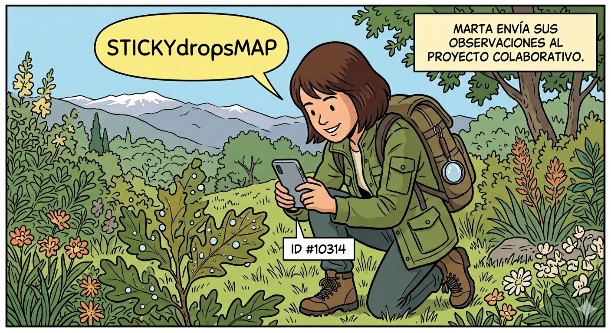

Bienvenido al proyecto de ciencia ciudadana **StickyDropsMap** de la Universidad de Granada.
Ayúdanos a cartografiar las plantas y superficies capaces de capturar agua atmosférica — como
niebla y rocío — para entender mejor los recursos hídricos de nuestros ecosistemas.

  <a href="/participate/" style="background-color: #2ea44f; color: white; padding: 15px 30px; text-decoration: none; border-radius: 8px; font-size: 1.2em; font-weight: bold; display: inline-block; box-shadow: 0 4px 6px rgba(0,0,0,0.1);">
    🙋🏽‍♀️ ¿Cómo puedo participar?
  </a>

---

## Mapa de especies vegetales singulares

  <iframe src="https://www.google.com/maps/d/embed?mid=1Ctys8roNKIREFzWwKuwVfj9vsDHdW3A&ehbc=2E312F" width="100%" height="500" style="border:0; border-radius: 12px; box-shadow: 0 4px 12px rgba(0,0,0,0.1);" allowfullscreen="" loading="lazy"></iframe>

---

## Monitorización Agroclimática de Niebla y Rocío (Red IFAPA)

<!-- Carga de Chart.js -->

  

    

      <label for="selProvincia">Provincia:</label>
      <select id="selProvincia">
        <option value="18" selected>Granada</option>
        <option value="29">Málaga</option>
        <option value="4">Almería</option>
        <option value="41">Sevilla</option>
        <option value="14">Córdoba</option>
      </select>
    

    

      <label for="selEstacion">Estación:</label>
      <select id="selEstacion"><option value="">Cargando...</option></select>
    

    

      <label for="fechaInicio">Fecha Inicio:</label>
      <input type="date" id="fechaInicio">
    

    

      <label for="fechaFin">Fecha Fin:</label>
      <input type="date" id="fechaFin">
    

    <button id="btnConsultar">Consultar Datos</button>
  

  

  
  

    <canvas id="meteorologiaChart"></canvas>
  

---

## Últimas observaciones de iNaturalist

  
⏳ Cargando observaciones…

  

    No se pudieron cargar las observaciones. Por favor,
    <a href="https://www.inaturalist.org/projects/mapa-de-superficies-vegetales-con-alta-captacion-de-agua-atmosferica" target="_blank" rel="noopener">
      visita el proyecto en iNaturalist
    </a>.
  

  

